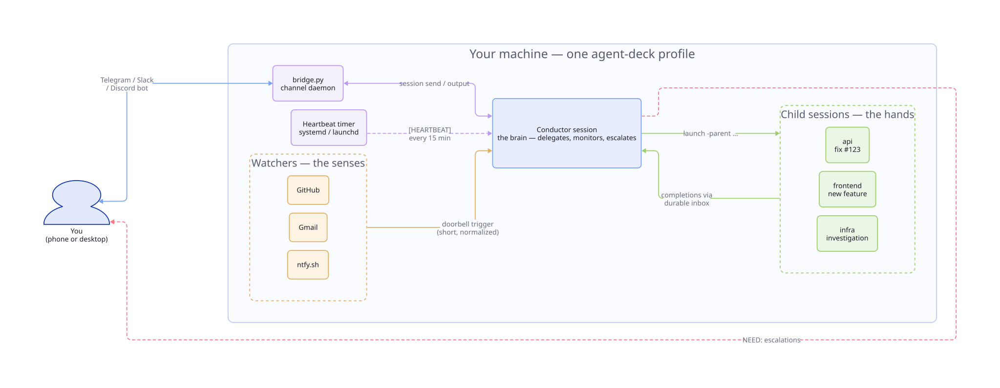

# Conductor and watchers

[Back to the README](../../README.md) . [Guide index](README.md)

## Quickstart: orchestrate a fleet of AI agents

Five minutes from zero to a Telegram bot that watches every Claude session you have running.

```bash
# 1. Create a Telegram bot via @BotFather, grab the token + your user ID from @userinfobot.
# 2. Run the wizard — it sets up the conductor, bridge daemon, and heartbeat in one shot.
agent-deck conductor setup work --description "Work fleet"
agent-deck session start conductor-work
# 3. Message your bot:  /status
```

That's it. From now on every other agent-deck session you run is supervised by a single
"conductor" session that answers routine questions, escalates the interesting ones to your
phone, and never lets a `waiting` worker rot.

Two short guides to read next:

- [**`docs/conductor/`**](../../docs/conductor/) — two-minute local quickstart, architecture,
  state files, lifecycle, remote channel setup (Telegram/Slack/Discord/Mattermost), gotchas.
- [**`docs/WATCHER-SETUP.md`**](../../docs/WATCHER-SETUP.md) — add "doorbells" so the outside world
  (GitHub events, gmail, ntfy pushes, meetings) can wake the conductor up.



## Conductor

Conductors are persistent agent sessions that monitor and orchestrate all your other sessions. They watch for sessions that need help, auto-respond when confident, and escalate to you when they can't. Optionally connect **Telegram**, **Slack**, **Discord** or **Mattermost** for remote control (see [docs/conductor/](../../docs/conductor/)).

Create as many conductors as you need per profile:

```bash
# First-time setup (asks about Telegram/Slack, then creates the conductor)
agent-deck -p work conductor setup ops --description "Ops monitor"

# Add more conductors to the same profile (no prompts)
agent-deck -p work conductor setup infra --description "Infra watcher"
agent-deck conductor setup personal --description "Personal project monitor"

# Run a conductor on Codex instead of Claude Code
agent-deck -p work conductor setup review --agent codex --description "Codex reviewer"

# Use a custom agent endpoint via environment variables
agent-deck conductor setup glm-bot \
  -env ANTHROPIC_BASE_URL=https://api.z.ai/api/anthropic \
  -env ANTHROPIC_AUTH_TOKEN=<token> \
  -env ANTHROPIC_DEFAULT_OPUS_MODEL=glm-5

# Or use an env file
agent-deck conductor setup glm-bot -env-file ~/.conductor.env
```

Each conductor gets its own directory, identity, and settings under the XDG data
root (default `~/.local/share/agent-deck/conductor/`):

```
~/.local/share/agent-deck/conductor/
├── CLAUDE.md           # Shared knowledge for Claude conductors
├── AGENTS.md           # Shared knowledge for Codex conductors
├── bridge.py           # Bridge daemon (Telegram/Slack, if configured)
├── ops/
│   ├── CLAUDE.md       # Identity: "You are ops, a conductor for the work profile"
│   ├── meta.json       # Config: name, profile, description, env vars
│   ├── state.json      # Runtime state
│   └── task-log.md     # Action log
└── review/
    ├── AGENTS.md
    └── meta.json
```

Claude conductors use `CLAUDE.md`. Codex conductors use `AGENTS.md`. Shared `POLICY.md` and `LEARNINGS.md` remain agent-neutral.

**CLI commands:**

```bash
agent-deck conductor list                    # List all conductors
agent-deck conductor list --profile work     # Filter by profile
agent-deck conductor status                  # Health check (all)
agent-deck conductor status ops              # Health check (specific)
agent-deck conductor teardown ops            # Stop a conductor
agent-deck conductor teardown --all --remove # Remove everything
```

**Telegram bridge** (optional): Connect a Telegram bot for mobile monitoring. The bridge routes messages to specific conductors using a `name: message` prefix:

```
ops: check the frontend session      → routes to conductor-ops
infra: restart all error sessions    → routes to conductor-infra
/status                              → aggregated status across all profiles
```

**Slack bridge** (optional): Connect a Slack bot for channel-based monitoring via Socket Mode. The bot listens in a dedicated channel and replies in threads to keep the channel clean. Uses the same `name: message` routing, plus slash commands:

```
ops: check the frontend session      → routes to conductor-ops (reply in thread)
/ad-status                           → aggregated status across all profiles
/ad-sessions                         → list active sessions
/ad-restart [name]                   → restart a conductor
/ad-help                             → list available commands
```

<details>
<summary><b>Slack setup</b></summary>

1. Create a Slack app at [api.slack.com/apps](https://api.slack.com/apps)
2. Enable **Socket Mode** → generate an app-level token (`xapp-...`)
3. Under **OAuth & Permissions**, add bot scopes: `chat:write`, `channels:history`, `channels:read`, `app_mentions:read`
4. Under **Event Subscriptions**, subscribe to bot events: `message.channels`, `app_mention`
5. If using slash commands, create: `/ad-status`, `/ad-sessions`, `/ad-restart`, `/ad-help`
6. Install the app to your workspace
7. Invite the bot to your channel (`/invite @botname`)
8. Run `agent-deck conductor setup <name>` and enter your bot token (`xoxb-...`), app token (`xapp-...`), and channel ID (`C01234...`)

</details>

Both Telegram and Slack can run simultaneously — the bridge daemon handles both concurrently and relays responses on-demand, plus periodic heartbeat alerts to configured platforms.

**Built-in status-driven notifications**: conductor setup also installs a transition notifier daemon (`agent-deck notify-daemon`) that watches status transitions and sends parent nudges when child sessions move `running -> waiting|error|idle`.

Dispatch can be suppressed at two scopes (PR #580, v1.7.34):

```toml
# Global kill switch in $XDG_CONFIG_HOME/agent-deck/config.toml
# (default ~/.config/agent-deck/config.toml)
[notifications]
transition_events = false
```

```bash
# Per-session at creation
agent-deck add --no-transition-notify -c claude .
agent-deck -p work launch . --no-transition-notify -c claude -m "Do task"

# Per-session at runtime
agent-deck session set-transition-notify worker off
agent-deck session set-transition-notify worker on
```

Suppression only affects dispatch — the parent link itself is unchanged. Deferred/retried events also honour the flag (guard is in `transition_notifier.dispatch` as well as both daemon entry points). A muted child's completion (`===AGENTDECK_DONE===`) is still recorded, so `agent-deck session children` shows it, and logged as `done_suppressed`; it is neither delivered to the parent nor exported.

**Heartbeat-driven monitoring**: heartbeats still run on the configured interval (default 15 minutes) as a secondary safety net. If a conductor response includes `NEED:`, the bridge forwards that alert to Telegram and/or Slack.

**Telegram conductor topology (v1.7.22+)**: each conductor bot must own exactly one channel-owning session. Activate telegram per-session with the session's `channels` field (`agent-deck add --channel plugin:telegram@claude-plugins-official`, or `session set <id> channels ...`; agent-deck passes it to Claude as `--channels`) and inject `TELEGRAM_STATE_DIR` via `[conductors.<name>.claude].env_file` in `$XDG_CONFIG_HOME/agent-deck/config.toml`. Do NOT set `enabledPlugins."telegram@claude-plugins-official"=true` in a profile's `settings.json` — that leaks a poller to every claude session under the profile. agent-deck emits warnings (`GLOBAL_ANTIPATTERN`, `DOUBLE_LOAD`, `WRAPPER_DEPRECATED`) when it detects these setups. Full guidance: [Telegram conductor topology](../../skills/agent-deck/references/gotchas.md#telegram-conductor-topology-v1722).

**Permission prompts during automation**: if a conductor keeps pausing on permission requests, set `[claude].allow_dangerous_mode = true` (or `dangerous_mode = true`) in `$XDG_CONFIG_HOME/agent-deck/config.toml`, then run `agent-deck session restart conductor-<name>`. See [Troubleshooting](../../skills/agent-deck/references/troubleshooting.md#conductor-keeps-asking-for-permissions).

**Legacy external watcher scripts**: optional only. `~/.agent-deck/events/` is not required for notification routing.

**Launching sessions from inside a conductor**:

```bash
# Inherit current conductor as parent (default when AGENT_DECK_SESSION_ID is set)
agent-deck -p work launch . -t "child-task" -c claude -m "Do task"

# Keep parent notifications and still force a custom group
agent-deck -p work launch . -t "review-phantom" -g ard -c claude -m "Review dataset"

# Tool command with extra args is supported directly
agent-deck -p work launch . -c "codex --dangerously-bypass-approvals-and-sandbox"
```

When `--cmd` includes extra args, agent-deck auto-wraps the tool command so args are preserved reliably.
Use `--no-parent` only when you explicitly want to disable parent routing/notifications.

### Channels (Telegram / Slack)

Channels are how a conductor talks to you remotely. Each conductor pairs **one-to-one** with its own bot — bots are not shared between conductors. `agent-deck conductor setup` walks you through the pairing during creation.

Key constraints:

- **One bot per conductor.** The Telegram Bot API delivers updates via long-poll; a second consumer on the same token causes 409 conflicts and dropped messages.
- **Plugin must be installed under the conductor's Claude profile but never globally enabled.** Per-session activation happens via the `channels = ["plugin:telegram@claude-plugins-official"]` field on the conductor's session record. A globally-enabled plugin leaks pollers into every Claude session under that profile.
- **Bot tokens** live in the per-conductor channel state directory at `<state-dir>/.env` (chmod 600). Never committed to git.

Slack pairing follows the same one-bot-per-conductor pattern. See [docs/conductor/](../../docs/conductor/) for the full quickstart, including @BotFather steps, profile config, and verification commands.

### See also

- [docs/conductor/](../../docs/conductor/) — full conductor guide with channel pairing walkthrough
- [documentation/WATCHDOG.md](../../documentation/WATCHDOG.md) — optional auto-restart daemon that complements conductors

## Watchers

Watchers listen for inbound events (webhooks, push notifications, GitHub events, Slack messages) and route them to conductor sessions so running agents can act on them automatically. Four adapter types ship today:

| Type | Use case | Required flags |
|------|----------|----------------|
| `webhook` | Generic HTTP POST listener for any service that can fire a webhook; requests are signed with a shared secret | `--port` (secret: generated, or `$WEBHOOK_SECRET` / `--secret-file`) |
| `github` | GitHub repository webhooks (issues, PRs, pushes) with HMAC-SHA256 verification | `$GITHUB_WEBHOOK_SECRET` or `--secret-file` (inline `--secret` is refused) |
| `ntfy` | [ntfy.sh](https://ntfy.sh) push-notification topics (phone / browser → conductor) | `--topic` or `--random-topic` |
| `slack` | Slack messages via a Cloudflare Worker bridge into an ntfy topic | `--topic` or `--random-topic` |

```bash
# Create, start, test — mirrors the four examples from `agent-deck watcher --help`
agent-deck watcher create webhook  --name my-webhook  --port 9000
agent-deck watcher create github   --name gh-alerts   --secret-file ~/.gh-webhook-secret  # chmod 600
agent-deck watcher create ntfy     --name phone       --random-topic
agent-deck watcher create slack    --name team-slack  --random-topic

agent-deck watcher start  <name>
agent-deck watcher list                # health + events/hour per watcher
agent-deck watcher status <name>       # detail view including recent events
agent-deck watcher test   <name>       # fire a synthetic event to verify routing
```

Routing rules live in the effective watcher data dir (`${XDG_DATA_HOME:-$HOME/.local/share}/agent-deck/watcher/clients.json` for new users, or legacy `~/.agent-deck/watcher/clients.json` when existing watcher state is present). Edit it to pick which conductor/group receives which events. Use `agent-deck watcher routes` to see the currently-loaded rules across all watchers.

**Conversational setup (recommended for first-time use):**

```bash
agent-deck watcher install-skill watcher-creator
```

Then, inside a Claude Code session started by agent-deck, ask: *"Use the watcher-creator skill to set up a GitHub watcher"*. The skill walks through adapter selection, required settings, and emits the exact `agent-deck watcher create` command to run.

Safety notes:
- The GitHub adapter enforces HMAC-SHA256 signature verification on every webhook — a missing/invalid signature drops the event.
- `watcher create webhook` generates a random secret (or takes `$WEBHOOK_SECRET` / `--secret-file`, chmod 600), stores it in the watcher's `watcher.toml` `[source]`, and prints a signing example. Each request must carry `X-Webhook-Timestamp` (unix seconds, within 5 minutes) and `X-Webhook-Signature-256: sha256=<HMAC-SHA256 of timestamp, X-Webhook-Sender and body, joined by newlines>`, or it gets 401; the signature covers the sender that picks the routed conductor, and a replayed signature gets 409. On a loopback bind `X-Webhook-Token: <secret>` is accepted instead (replayable by local processes); on any other bind it is refused. The secret must be at least 16 bytes, and a `watcher.toml` that does not parse stops the watcher from starting. Requests with an `Origin` header (browser pages) get 403, and on a loopback bind with no secret so does any `Host` other than `localhost` / `127.0.0.1` / `[::1]`. A webhook watcher without a secret only starts on a loopback bind, and logs a WARNING.
- On the public `https://ntfy.sh` (the default server for `ntfy` and `slack`), anyone who knows a topic can read it and post fake events to it. Use `--random-topic`, or run your own ntfy server (see [ntfy self-hosting](https://docs.ntfy.sh/install/)) with access control and pass `--server https://ntfy.example.com` plus an access token from `$NTFY_TOKEN` or `--token-file <path>` (chmod 600). The token is stored in the 0600 `watcher.toml` and sent as `Authorization: Bearer`. `watcher create` and watcher startup print a warning for a guessable topic (shorter than 16 characters, or no digit in it) on ntfy.sh without a token.
- Events are deduplicated in SQLite by `(watcher_name, event_id)`, so retries from the sender do not double-fire the conductor.
- Watchers keep per-adapter health in `<effective watcher data dir>/<name>/state.json`; the TUI watcher panel (press `w`) surfaces this in real time.

**Doorbell rule:** watchers are triggers, not launchers. They forward a short event string to the conductor and let the conductor decide what to do. A watcher should never call `agent-deck launch` or `agent-deck add` directly — those calls run outside any conductor's process and have no `$AGENTDECK_INSTANCE_ID`, so the spawned session becomes an orphan whose status events never route back. Use `agent-deck session send <conductor> "[event] hint"` from the watcher and let the conductor fan out from there.

### See also

- [documentation/WATCHERS.md](../../documentation/WATCHERS.md) — full watcher guide with adapter recipes, custom external watchers, security guarantees, and gotchas
