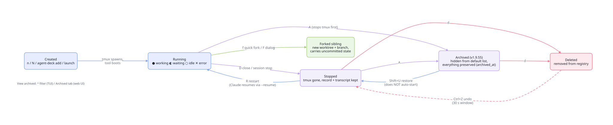

# Sessions, groups and config

[Back to the README](../../README.md) . [Guide index](README.md)

## Features

### MCP Manager

Attach MCP servers without touching config files. Need web search? Browser automation? Toggle them on per project or globally. Agent Deck handles the restart automatically.

- Press `m` to open, `Space` to toggle, `Tab` to cycle scope (LOCAL/GLOBAL), type to jump
- Define your MCPs once in `$XDG_CONFIG_HOME/agent-deck/config.toml` (default `~/.config/agent-deck/config.toml`), then toggle per session — see [Configuration Reference](../../skills/agent-deck/references/config-reference.md)

### Skills Manager

Attach/detach Claude skills per project with a managed pool workflow.

- Press `s` to open Skills Manager for a Claude session
- Available list is pool-only (`$XDG_CONFIG_HOME/agent-deck/skills/pool`, default `~/.config/agent-deck/skills/pool`) to keep attach/detach deterministic
- Apply writes project state to `.agent-deck/skills.toml` and materializes into `.claude/skills`
- Type-to-jump is supported in the dialog (same pattern as MCP Manager)

### Declarative groups

Declare groups in `config.toml` so they exist on startup. Set `create = true` to ensure a group exists, and `default_path` to set the working directory for new sessions in it:

```toml
[groups."staging"]
create = true                      # ensure the group exists

[groups."projects/devops"]
create = true
default_path = "~/repos/devops"    # working directory for new sessions
```

On startup each group with `create = true` is created if missing (along with any parent groups). `default_path` is written to the state DB for any group that exists — including groups created from your sessions — so `create = true` is optional when the group is already there. Reconciliation is additive: removing a group from `config.toml` leaves the group and its sessions in place, and omitting `default_path` keeps any value already set. Clear a default with `agent-deck group update <name> --clear-default-path`.

### Per-group Claude config

Agent Deck supports per-group `CLAUDE_CONFIG_DIR` and `env_file` overrides. Useful when a single profile hosts groups that should authenticate against different Claude accounts — for example, a personal profile hosting a `conductor` group pinned to `~/.claude-team` while other groups stay on `~/.claude`.

Override any group by adding a `[groups."<name>".claude]` table to `$XDG_CONFIG_HOME/agent-deck/config.toml` (default `~/.config/agent-deck/config.toml`):

```toml
[groups."conductor".claude]
config_dir = "~/.claude-team"
env_file = "~/git/work/.envrc"
```

Lookup priority: `account > conductor > group > env > profile > global > default`. The `env_file` is `source`d into the tmux pane before `claude` (or the custom command) execs, so any exports it contains become part of the session environment.

Human-watchable verification: `bash scripts/verify-per-group-claude-config.sh`. The harness creates two throwaway groups, launches one normal and one custom-command session, and prints a pass/fail table.

#### Per-conductor Claude config (v1.5.4)

Conductors are first-class agent-deck entities (see `agent-deck conductor setup`). Each conductor can carry its own Claude `config_dir` and `env_file` via a top-level `[conductors.<name>.claude]` block:

```toml
[conductors.gsd-v154.claude]
config_dir = "~/.claude-team"
env_file = "~/git/work/.envrc"
```

The conductor name is the string you passed to `agent-deck conductor setup <name>` — it's the same name that appears in session titles (`conductor-<name>`).

**Precedence chain** (most-specific → least-specific):

1. The session's account (`--account <name>` → `[profiles.<name>.claude]`)
2. `[conductors.<name>.claude]` (when the session is a conductor session, i.e. Title starts with `conductor-`)
3. `[groups."<group>".claude]`
4. `CLAUDE_CONFIG_DIR` env var
5. `[profiles.<profile>.claude]`
6. `[claude]` (global)
7. `~/.claude` (default)

This means a single `[conductors.gsd-v154.claude]` line replaces the need to duplicate the config into `[groups."conductor".claude]` — the conductor block scopes to exactly that conductor, not to every conductor that shares the `conductor` group.

Backward compat: sessions in the `conductor` group with NO matching `[conductors.<name>.claude]` block continue to resolve via `[groups."conductor".claude]`.

#### Context window and the proactive `/clear`

The session analytics context bar divides the current prompt size by the model's context window. A model id does not carry its window, so a size read off the model-id table is shown as `≈49.5% (window inferred from model id)`, a reading larger than that table figure is shown as over-limit with the figure named (the window is then unknown, not 100% full), and an id the table has never seen shows `window unknown`. Set `AGENTDECK_CONTEXT_WINDOW=<tokens>` in the deck's environment to supply the real size; it renders plain, with no `≈`.

A conductor's proactive `/clear` (`clear_on_compact`) only arms on an established window — that variable, or a size the harness reported. On an inferred, unknown or disproved window it stays off and the conductor falls back to Claude's own compaction; the reason is logged once per session as `conductor_clear_on_compact_disarmed`. See [issue #2026](https://github.com/asheshgoplani/agent-deck/issues/2026).

#### Switch a session's account on the fly

For a new one-shot session, use `agent-deck launch . -c claude --account <name>`.
Run `agent-deck accounts` (or `agent-deck accounts --json`) to list named slots
configured under `[profiles.<name>.claude].config_dir`.

To put every *new* Claude session on one slot until you change it (say, while
another account is near its weekly limit), set a default account:
`agent-deck config set claude.default_account work`, or Settings (`S`) →
Claude → Default account. The New Session dialog then starts on
`work (default)`, and `add` / `launch` without `--account` use it too.
Existing sessions keep their account, a group or conductor `config_dir` still
wins, and this machine's default never travels to a remote (a remote server
applies its own `default_account`, if it has one). See
[`default_account`](../../skills/agent-deck/references/config-reference.md#claude-section).

`agent-deck session switch-account <session> <account>` moves an existing session to another Claude account — **conversation included**. The session stops, its conversation file is migrated into the target account's config dir (copy-only, with a destination backup and size verification), the account is set, and the session restarts with `--resume`. `session set <session> account <name>` auto-migrates too. Claude Code may key one working directory under several project directories (the path as typed, its macOS `/private` form, its realpath); every copy of the conversation under those keys in both accounts is considered, the newest by last event wins (tie: longest), it is installed under every key in the target, each copy it replaces is backed up next to it, and a newer target copy is never overwritten. The receipt names the chosen copy; `--json` lists every candidate under `transcript`.

The TUI exposes the same two moments. The **New Session** dialog's Claude options
carry an `Account` row (`←`/`→` or `Space` to cycle, `inherit` = today's
conductor/group/env chain), so a session can be created straight onto the right
login. The **Edit Session** dialog (`Shift+P`) carries an account row for a
session that already exists; saving it asks "Switch Account?" first, then runs the same
migrate-and-resume flow as `session switch-account`, and the session card's
`[account:"…"]` badge follows. Both rows are hidden when no
`[profiles.<name>.claude].config_dir` blocks are configured.

Rows of a remote deck get the same dialog: `Shift+P` on a remote session lists
that remote's own slots, previews the switch there (`session switch-preview`)
and, once confirmed, runs the remote's own `session switch`; transcripts and
credentials never leave the remote. See
[docs/REMOTE-COMMANDS.md](../../docs/REMOTE-COMMANDS.md#switching-a-remote-sessions-account-or-harness).

### Session naming

Titles and groups answer different questions — "what is this, at a glance?" versus "why do these sessions belong together?" — and each has its own controls.

#### Stable titles

By default, agent-deck syncs a session's displayed title from the tool's own session name (Claude's `/rename`, `claude --name`, etc.), which is useful for watching a list of live agents but means a title you set can later be overwritten. Pick the control that matches how stable you need the title to be:

| You want | Do this |
| --- | --- |
| This one session keeps the title I gave it | `--title-lock` (alias `--no-title-sync`) on `agent-deck add` / `agent-deck launch`, or `agent-deck session set-title-lock <id> on` at runtime |
| No session in this installation ever gets renamed by its agent | `sync_title = false` in `config.toml` |
| Claude should receive the exact deck title at startup | supported Claude launch/restart/resume commands get `--name`; `push_title = false` opts out. A deck rename takes effect on the next start, not immediately. |
| A throwaway session where the live task description matters more than a fixed name | `agent-deck add --quick` (`-Q` short flag) — the list shows the session's current Claude task in place of the generated handle |

An explicit `-t/--title` locks the title automatically, the same as passing `--title-lock` — there's no separate opt-in needed. There's also no create-time opt-out: if you want a session with an explicit title to still pick up the agent's renames, unlock it afterward with `agent-deck session set-title-lock <id> off`. A locked title is never silently overwritten by the sync path — it only changes via an explicit rename or `session set-title-lock <id> off`.

#### Groups vs. parent linkage

Groups carry real policy — `max_concurrent` (serial vs. bounded parallelism), `default_path`, and per-group Claude account/config (see [Declarative groups](#declarative-groups) and [Per-group Claude config](#per-group-claude-config) above). Treat that policy as the test for whether a new group is warranted:

- **Don't encode dispatch relationships in a group name.** A conductor fanning out workers doesn't need `work`, `work-infra`, `work-hygiene` siblings to say "these came from the same orchestrator" — that's what parent linkage is for. Launch with `--parent <id>` (or let `agent-deck launch` auto-parent), and read the fleet back with `agent-deck session children`.
- **Create a new group when something policy-shaped differs** from the parent group — a different concurrency cap, working directory, or Claude account. If nothing enforced differs, the thing you have is a topic, not a group; carry it in the title and parent linkage instead.
- **Don't rely on titles or group names as machine keys.** Both are user-editable; a script or agent matching on either is relying on something that can change under it.

There's no automated warning or enforcement for group sprawl yet — this is a documented convention, not a gate. See [`docs/design/2026-07-26-session-identity-and-group-purpose.md`](../../docs/design/2026-07-26-session-identity-and-group-purpose.md) for the fuller design writeup (task-identity field, group `--purpose`, advisory sprawl warning) if you hit a concrete gap this section doesn't cover.

### MCP Socket Pool

Running many sessions? Socket pooling shares MCP processes across all sessions via Unix sockets, so each server runs once instead of once per session. A health check every 3 seconds restarts a crashed MCP behind a reconnecting proxy. Enable with `pool_all = true` in [config.toml](../../skills/agent-deck/references/config-reference.md).

### Search

Press `/` to fuzzy-search across all sessions. Filter by status with `!` (running), `@` (waiting), `#` (idle), `&` (error). Press `0` to clear the filter. Press `$` for the Cost Dashboard and `G` for Recall search across every conversation on this machine.

### Keyboard navigation (v1.7.60)

Two tiers of keybindings move the cursor around the session list. The global tier is unchanged from earlier versions; the `Alt+` tier (added in v1.7.60) restricts movement to the current group only. Press `?` in the TUI to see the full table in-app.

| Scope | Keys | What it does |
|---|---|---|
| **Global (flat list)** | `j` / `k` or `↓` / `↑` | Move cursor down / up through every item |
| Global | `Home` / `End` | Jump to top / bottom of list |
| Global | `G` | Open Recall search across every conversation on this machine |
| Global | `1`–`9` | Jump to Nth root group header |
| Global | `/` | Open fuzzy search across all sessions |
| **Group (current group only)** | `Alt+j` / `Alt+k` | Next / previous session in current group (skips group boundaries) |
| Group | `Alt+1`–`Alt+9` | Jump to Nth session within the current group |
| Group | `Alt+g` / `Alt+G` | First / last session in current group |
| Group | `Alt+/` | Open fuzzy search filtered to the current group's sessions |

"Current group" is derived from the cursor position: on a session it's that session's group; on a group header it's that group; on a window it's the parent session's group. On a group boundary `Alt+j` / `Alt+k` no-op rather than spilling into the next group.

### Status Detection

Smart polling detects what every agent is doing right now:

| Status | Symbol | What It Means |
|--------|--------|---------------|
| **Running** | `●` green | Agent is actively working |
| **Waiting** | `◐` yellow | Needs your input |
| **Idle** | `○` gray | Ready for commands |
| **Error** | `✕` red | Something went wrong |

### Notification Bar

Waiting sessions appear right in your tmux status bar. Press `Ctrl+b`, release, then press `1`–`6` to jump directly to them.

```
⚡ [1] frontend [2] api [3] backend
```

By default the session that started waiting most recently is `[1]`. To order the bar by the session you used most recently instead, like Alt+Tab, set `sort = "last_accessed"` under `[notifications]` in `config.toml` (default: `"waiting"`). Only visits through the agent-deck TUI count: attaching from its session list and jumping with the bar's `Ctrl+b` number keys. Attaching with the `agent-deck` CLI or the web UI does not change the order. `minimal = true` ignores `sort`.

## Forking sessions

Press `f` to **quick-fork** the selected session, or `Shift+F` for the fork **dialog** (customize title, group, branch, and toggles). A fork inherits the parent's conversation context through each tool's native fork — supported for **Claude, OpenCode, Pi, Codex, and Oh My Pi** (and Codex-compatible custom tools) across the TUI, CLI (`agent-deck session fork <id>`), and Web UI.

Quick fork (`f`) is **comprehensive by default**: it creates a new git worktree + branch, carries the parent's uncommitted working-tree state, matches the parent's Docker isolation, and inherits the parent's Claude launch options. The `Shift+F` dialog opens pre-seeded from the same defaults ("comprehensive, tweak down"). Jujutsu (jj) repos are supported too — the fork materializes the parent's working state into a new jj workspace.

Tune the defaults in `$XDG_CONFIG_HOME/agent-deck/config.toml` (default `~/.config/agent-deck/config.toml`):

```toml
[fork]
inherit_from_parent = false   # true => mirror the parent and ignore the keys below
worktree            = true    # create a new worktree + branch for the fork
with_state          = true    # carry the parent's uncommitted changes into the fork
with_ignored        = false   # also copy gitignored files (implies with_state) — opt-in
docker              = "auto"  # "auto" = match parent | "on" = always | "off" = never
branch_prefix       = "fork/" # auto branch name = <branch_prefix><sanitized-title>
```

- Unset keys default to the values shown above. The `[fork]` section is **independent** of `[worktree].default_enabled` / `[docker].default_enabled` (those govern non-fork session creation).
- `docker = "auto"` forks into a fresh container only when the parent is already sandboxed.
- `branch_prefix` applies to both quick fork and the dialog's suggested branch name.
- `with_ignored` is **off by default** (since v1.9.54): the gitignored tree is unbounded (`node_modules`, datasets, virtual envs) and can carry secrets (`.env`), and copying it silently can block the fork on heavy repos. Opt in globally here, or per fork in the `Shift+F` dialog.

> **Web/API fork** (`POST /api/sessions/{id}/fork`) is plain tool-native fork — it does **not** apply `[fork]` worktree/state/Docker defaults (those are TUI quick-fork/dialog scope).
> **Codex** forking requires a codex CLI with `codex fork <session-id>` support.

## Archive Sessions

Done with a session but not ready to delete it? Archive it. Archiving stops the tmux process and hides the session from the default list — the conversation, metadata, worktree, and parent linkage are all preserved.

- `A` archives the selected session; `Shift+U` restores it to the active list **without** auto-starting the process
- `R` on an archived session restores it to the active list and restarts its process
- `^` filters the TUI to archived sessions; the web UI has a dedicated **Archived** tab
- Search and filters work across archived sessions
- Deleting (`d`) is the destructive cousin — it removes the session from the registry (`Ctrl+Z` undoes recent deletes while the TUI stays open; the web UI gives 30 seconds)



## Socket Isolation (v1.7.50+)

Run agent-deck on its own tmux server so it never touches your interactive tmux's config, bindings, or sessions. Opt-in via a single config line:

```toml
# $XDG_CONFIG_HOME/agent-deck/config.toml
# default ~/.config/agent-deck/config.toml
[tmux]
socket_name = "agent-deck"
```

With this set, every agent-deck session is spawned as `tmux -L agent-deck …` — a fully isolated tmux server whose socket lives at `$TMUX_TMPDIR/tmux-<uid>/agent-deck` (or `/tmp/tmux-<uid>/agent-deck` when `TMUX_TMPDIR` is unset, the standard tmux fallback). Your regular tmux server at `default` is never touched.

**What this buys you:**
- `[tmux].inject_status_line`, bind-key, and global `set-option` mutations stay on the agent-deck server. Your personal status bar, plugins, and theme are untouched.
- A stray `tmux kill-server` in your shell cannot take agent-deck's managed sessions down with it.
- `tmux -L agent-deck ls` from the shell shows exactly agent-deck's sessions — no mixing with your own work sessions.
- Fixes [#276](https://github.com/asheshgoplani/agent-deck/issues/276) and [#687](https://github.com/asheshgoplani/agent-deck/issues/687) at the root, not via per-option sentinels.

**Default behavior unchanged.** Leave `socket_name` unset (the default) and agent-deck behaves exactly like v1.7.46: it uses your default tmux server. This is a pure opt-in.

**What socket isolation does not cover.** `socket_name` isolates agent-deck from *other* tmux servers on the host — a `tmux kill-server` in your shell, a stray `set-option -g` from your personal config, or an interactive session competing for the same socket. It does **not** harden agent-deck's own tmux server against bugs inside tmux itself. If agent-deck's internal session churn trips a tmux bug (for example, a control-mode race in older tmux builds), that failure happens on the isolated socket just as it would on the default one. The isolation boundary is "other tmux instances," not "all possible tmux crashes." Keep your tmux up to date alongside agent-deck.

**Per-session override.** The `agent-deck add` and `agent-deck launch` commands both accept `--tmux-socket <name>` to override the installation-wide default for one session:

```bash
# One-off isolated session even though config says otherwise
agent-deck add --tmux-socket experiment -c claude .
agent-deck launch --tmux-socket experiment -c claude -m "Try the risky thing"
```

Precedence at session creation: `--tmux-socket` flag > `[tmux].socket_name` > empty.

**Immutable after creation.** Each session captures its socket name in SQLite at creation time. Changing `socket_name` in config later does **not** migrate existing sessions — they stay on the socket they were created on, so restart/revive cycles keep reaching the right tmux server. This is deliberate: mixing sockets mid-life would strand sessions on an unreachable server.

**Migrating existing sessions.** There's no `migrate-socket` subcommand in this release. To move an existing session onto an isolated socket:

1. Set `[tmux].socket_name = "agent-deck"` in your config.
2. Stop the session (`agent-deck session stop <name>`) — this kills the tmux pane on the old server.
3. Restart it (`agent-deck session start <name>`) — agent-deck will see TmuxSocketName=`""` on the stored Instance, spawn a fresh pane on the old server, and keep it there. To force it onto the new socket, edit the effective profile database (`~/.local/share/agent-deck/<profile>/state.db` for new users, or `~/.agent-deck/<profile>/state.db` for legacy profiles):
   ```sql
   UPDATE instances SET tmux_socket_name = 'agent-deck' WHERE id = '<session-id>';
   ```
   then restart agent-deck. Subsequent starts will spawn on `tmux -L agent-deck`.
4. Easier: delete the old session with `agent-deck rm <name>` and re-create it with `agent-deck add` — the new row picks up the config-wide default.

**`TMUX_TMPDIR` is honored.** Socket path resolution follows tmux's standard rules: if you set `TMUX_TMPDIR=/custom/dir`, agent-deck's socket lives at `/custom/dir/tmux-<uid>/agent-deck`. No extra config needed.

## Feedback

Found a bug or have an idea? Send feedback without leaving your terminal. Press `Ctrl+E` in the TUI to open the FeedbackDialog, or run `agent-deck feedback` from the shell to submit a rating and a short note.

Feedback posts to a public GitHub Discussion at [Feedback Hub](https://github.com/asheshgoplani/agent-deck/discussions/600) so other users can read along, comment, and upvote. The CLI submit path uses `gh api graphql` under your local GitHub authentication — no telemetry, no third-party services.

- Press `Ctrl+E` from the main TUI to open the dialog
- Or run `agent-deck feedback` from the CLI (rating 1-5)
- **Nothing is sent until you explicitly type `y` at the confirmation prompt.** Before the prompt, the CLI shows (1) the public URL the comment will land on, (2) that it posts via the `gh` CLI using your account, (3) your GitHub username as it will appear, and (4) the exact body that will be posted. Default answer is **N** — pressing Enter declines.
- If `gh` fails (auth required, not installed, network), the CLI prints an error and exits non-zero. No clipboard or browser fallback is triggered on the CLI path.

### Report a bug or an idea

`agent-deck feedback bug` and `agent-deck feedback idea` turn a report into a GitHub issue on this repo, laid out like the bug and feature forms, so it can be filed in under a minute without leaving the terminal:

```bash
agent-deck feedback bug                       # asks what happened, what you expected, steps
agent-deck feedback bug --dry-run \
  --title "Typed letters doubled in a session" \
  --what "each key I type shows up twice" \
  --expected "each key once" --steps "1. open a session 2. type abc"
agent-deck feedback idea --title "Report a problem from the menu bar"
```

- A bug report carries the agent-deck version, OS, arch, terminal and the last lines of the agent-deck debug log. Paths under your home become `~`; tokens (also bare vendor keys such as GitLab, Hugging Face, Stripe, Shopify and SendGrid ones), key=value secrets, emails, hostnames and IP addresses are replaced with `<token>`, `<email>`, `<host>`, `<ip>`. Host names from agent-deck's `[remotes]` and your ssh config are replaced wherever a host goes (`ssh x`, `x:/path`, `lookup x`), and as plain words (also next to a dot, as in `x.sock`) only when they are distinctive (a `-`, `.` or digit, or 6+ letters, and not a common word such as `dev` or `mac`); a letters-only ssh `Host` alias that points at another `HostName` (`Host backup office`) is replaced only where a host goes. Logins of `[remotes]` and ssh-config `User` values are replaced as plain words too, except shared ones such as `git` or `root`, which are replaced only in `user@host` and `ssh -l`. Commit shas, sha256 digests and test names stay readable. What you type is scrubbed the same way.
- The issue body stays under 60000 bytes, so every preview can be sent: a very long field is cut and ends with `… (trimmed)`, and the log keeps its newest lines.
- **You see the full issue text before anything is sent**, and it is filed only when you answer `y` (default N). `--dry-run` prints the exact issue and sends nothing.
- With `gh` installed and logged in it files with `gh issue create` under your account. Otherwise your browser opens a prefilled new-issue page (the URL stays under 8000 characters; the log is trimmed first) and you press Submit there. `--no-open` prints that URL instead.
- In the TUI, press `Z` on the main screen (rebind with `[hotkeys].report_problem`). Pick bug or idea, fill in what happened, what you expected and optional steps, then press `Ctrl+P` (or Enter on the last field) to see the full issue. `y` files it the same way as the CLI; `e` goes back to edit; `Esc` cancels before `y` and nothing is sent. Once sending has started it cannot be cancelled (gh may already have filed it), so the dialog waits for the result.
- `--json` is for apps (the Mac app uses it): it never prompts, `--dry-run --json` returns the issue and the prefilled URL, and sending also needs `--yes`. To send exactly what was shown, pipe that JSON back: `agent-deck feedback bug --yes --json --issue -` (or `--issue FILE`) files its `title`, `labels` and `body` as they are, with no rebuild and no new log read. The handed-back issue is scrubbed again, must keep the form's sections and a title of at most 256 characters, and with `--yes` anything the scrubber would change is refused, so only a real preview goes through; `--issue` cannot be combined with `--surface` or the text flags. Errors come back as `error_code` (`invalid_input`, `confirm_required`, `gh_failed`, `browser_failed`).
- When the browser fallback has to trim the text to fit the URL (`url_trimmed: true`), every preview says so before you confirm.

**Feedback prompt frequency** (v1.7.41+): the TUI's auto-prompt is paced so brand-new users aren't asked on their first few launches. The first prompt appears only after **7 launches or 3 days** of use, whichever comes later. If you dismiss it, agent-deck waits **14 days** before asking again. You'll see at most **3 prompts per version**, and pressing `n` at any step opts you out permanently — use `agent-deck feedback` or `Ctrl+E` to re-enable on demand. Opt-out always wins over every pacing gate.

## Usage telemetry (opt-in, off by default)

Anonymous usage data (tools and features used, session counts and lengths, active hours, error types, version and OS; never prompts, paths, titles or names) is shared with the maintainer via PostHog EU **only after you say yes** to the one-time TUI question; `agent-deck telemetry preview` shows exactly what would be sent, and `agent-deck telemetry off` or `DO_NOT_TRACK=1` turns it off. Details and the full field list: [TELEMETRY.md](../../TELEMETRY.md). A separate `install.tick` uses a fresh daily nonce to count reporting installs, checked by the interactive TUI after the consent day; retries reuse that nonce. Owner installs suppress it with `[telemetry] owner = true` or `AGENTDECK_TELEMETRY_OWNER=1`. Status and TUI Settings show the last acknowledged tick day. Schema 3 asks existing opt-ins to accept the updated disclosure; schema-2 refusals remain final.

The website counts page views with PostHog EU, cookieless (in-memory only) and not at all when your browser sends Do Not Track or Global Privacy Control; see [TELEMETRY.md](../../TELEMETRY.md#website).

```bash
agent-deck telemetry status      # on/off, why, and what is waiting in the local spool
agent-deck telemetry preview     # the exact request bodies the next upload would send
agent-deck telemetry off         # off; install id, spool and counters deleted
```
